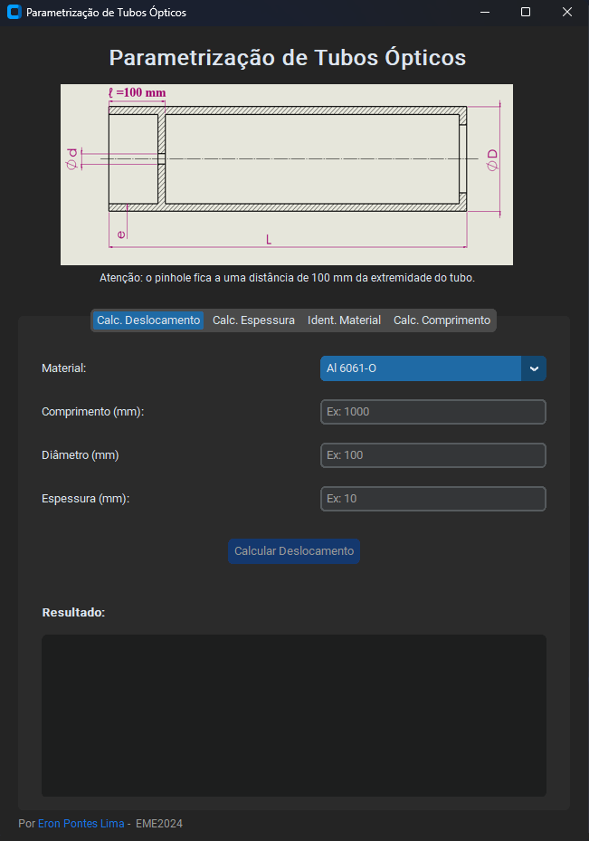

# Parametrização de Tubos Metálicos (PTM)

Parametrização de Tubos Metálicos (PTM) é um programa de computador desenvolvido através da linguagem de programação Python para a realização de cálculos e simulações relacionados a tubos metálicos circulares, a partir de um conjunto de dados de entrada fornecido pelo usuário. As funcionalidades de cálculo compreendem a determinação de dois parâmetros dimensionais do tubo, que são o comprimento ou a espessura. As funcionalidades de simulação retornam o resultado do comportamento do tubo para dois diferentes cenários. No primeiro,  é estimado o deslocamento vertical experimentado por um tubo metálico com uma de suas extremidades fixas numa parede, devido à ação de seu próprio peso. No segundo, o programa determina o material de fabricação do tubo, dentre as opções existentes no código, que mais se adeque às condições de entrada fornecidas pelo usuário.

